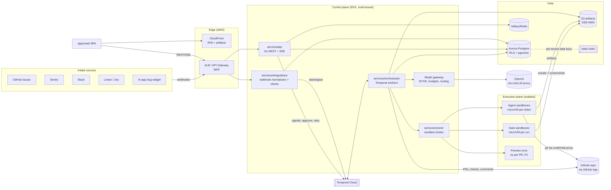
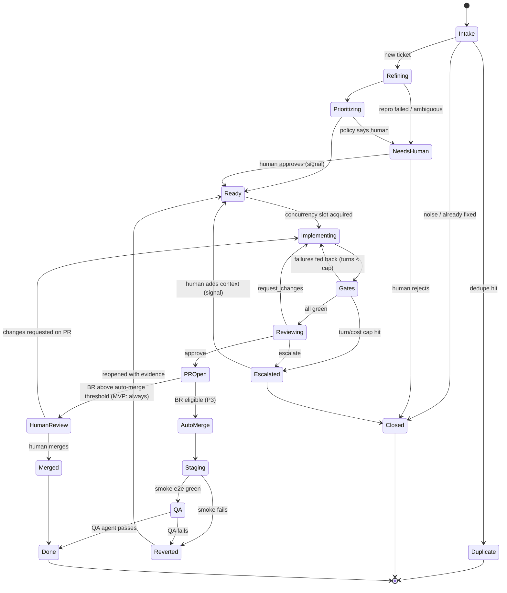
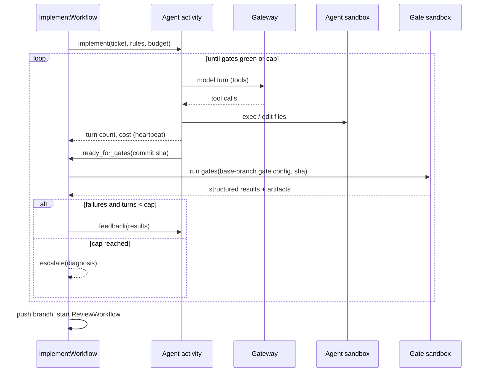

# Alpine — Architecture Spec

Version 0.1 · Oct 2026 · Clean-slate design (no existing infrastructure assumed)

## 1. Principles

1. **Durable by default.** A ticket's pipeline can run for hours or days (waiting on humans,
   staging, retries). Every step is a durable, resumable workflow step — never an in-memory loop.
2. **Deterministic around the probabilistic.** LLM steps are wrapped by deterministic inputs
   (schemas, configs) and deterministic checks (gates, policies). Gate config comes from the
   **base branch**, never the agent's branch.
3. **Agents get the least privilege that works.** No long-lived credentials in sandboxes, no prod
   data, egress allowlists, untrusted input never directly triggers privileged actions.
4. **Tenant isolation at every layer.** DB rows (RLS), encryption keys (per-tenant data keys),
   compute (one sandbox = one ticket = one tenant), object storage prefixes, model keys.
5. **Pluggable edges.** Sandbox provider, model provider, SCM, issue sources and gate tools are
   interfaces. We start managed, and in-source what becomes core cost or a compliance requirement.
6. **Boring core.** Go, Postgres, Temporal, Redis, S3, Kubernetes. No Kafka/microservice sprawl
   until load proves it necessary.

## 2. Stack decisions (validated / adjusted from the suggested backbone)

| Concern | Decision | Why / notes |
| --- | --- | --- |
| API language | **Go** | User requirement; great for concurrent I/O, single static binaries, strong Temporal SDK |
| API style | **REST + OpenAPI 3.1** (spec-first, `oapi-codegen` for Go server, `openapi-typescript` / `orval` for TS client); **SSE** for live board updates | Simple for a SPA + public API/webhooks; SSE is enough for one-way live updates (no WebSocket infra) |
| HTTP router | `chi` (or stdlib `net/http` mux) | Minimal, idiomatic |
| DB access | `pgx` + `sqlc`; migrations with `goose` (or Atlas) | Type-safe SQL, no ORM magic |
| Workflow engine | **Temporal** — **Temporal Cloud** for MVP, self-host option later | Durable per-ticket workflows, timers, signals (human approvals), retries, versioning. Cloud removes ops burden of Cassandra/Postgres-backed Temporal clusters early on. ✅ keep |
| Primary DB | **Postgres 16+** on **Aurora PostgreSQL** (or RDS) with **pgvector** | Relational core + vector dedupe in one store; RLS for tenancy. ✅ keep |
| Cache / ephemeral | **Redis-compatible (ElastiCache Valkey)** | Rate limits, idempotency keys, SSE fan-out pub/sub, short-lived locks. ✅ keep |
| Object storage | **S3** (+ CloudFront signed URLs) | Videos, screenshots, Playwright traces, logs, transcripts. Per-tenant prefixes + SSE-KMS. ✅ keep |
| Async ingress | Webhooks → **Postgres inbox table** (idempotent) → Temporal signal/start | Avoids a separate message bus in MVP. Add NATS JetStream / SQS only if fan-out grows |
| Sandboxes | **`Runner` interface**; MVP on a **managed microVM provider** (E2B / Daytona / Modal class — pick after a 1-week bake-off); P3 option: **own EKS node pools with Kata Containers (Firecracker) or gVisor** | Managed = fastest to market; own = cost control, data residency, BYO-cloud. Firecracker needs KVM → bare-metal or nested-virt-capable instances; gVisor runs on standard nodes but weaker isolation and some syscall gaps for Docker-in-sandbox. Adjusted: don't build our own microVM fleet in MVP |
| Preview envs | **Separate "preview" EKS cluster**, namespace per PR, built from repo's `devcontainer`/compose or Helm + seed recipe | P2. Isolated from control plane; strict NetworkPolicies; TTL reaper |
| SCM | **GitHub App** (MVP), GitLab app (P4) | Short-lived, repo-scoped installation tokens |
| Model access | **OpenAI is the model provider (founder decision).** Thin Go gateway client (`packages/shared/llm`) → **LiteLLM proxy** (OpenAI only for now). The gateway interface stays provider-agnostic | Gateway owns BYOK (customer's own OpenAI key), per-tenant limits/budgets, metering, retries/fallbacks, structured outputs; LiteLLM is a thin OpenAI-compatible hop. Model names are configurable per stage |
| Agent harness | **Alpine-owned control loop** in Go (turn accounting, budgets, tools, gates) with **engine adapters**: (a) native tool-calling loop via the gateway, (b) headless coding CLIs run inside the sandbox (e.g. Claude Code / Codex-style headless mode) | Own the loop = own turn caps, metrics and policy; adapters let us use the best harness per model |
| Frontend | **Vite + React + TypeScript SPA**, TanStack Router + TanStack Query, Tailwind + shadcn/ui (Radix), Recharts/visx for metrics, hosted on S3 + CloudFront | User requirement (no Next.js). Pure static SPA → cheap, cacheable, CSP-friendly |
| Auth (users) | GitHub OAuth login for MVP; **WorkOS** (or Ory/Keycloak self-host) for SAML/OIDC SSO + SCIM in P3 | B2B SSO is table stakes later; don't build SAML ourselves |
| Secrets | **AWS KMS** envelope encryption (per-tenant data keys) for BYOK + repo secrets stored in Postgres; platform secrets in **AWS Secrets Manager** via External Secrets Operator | |
| Observability | **OpenTelemetry** everywhere (traces/metrics/logs) → Grafana stack (Tempo/Mimir/Loki) or Honeycomb; LLM spans follow OTel GenAI semantic conventions | One trace per ticket workflow spanning API → Temporal → runner → gateway |
| Infra | **AWS**, **EKS** + **Karpenter**, **Terraform** (accounts/VPC/EKS/RDS/etc.), **Argo CD** GitOps for k8s manifests (Helm/Kustomize) | ✅ keep |
| CI for Alpine | GitHub Actions; container builds with ko (Go) / Docker buildx; images to ECR; cosign signing | Dogfood Alpine gates on Alpine |

## 3. System context



## 4. Services

### 4.1 `services/api` (Go)
- Public REST API (OpenAPI), session auth for SPA (HTTP-only cookie, CSRF token), API keys for programmatic access.
- Resources: orgs, members, installations, repos, factory configs, tickets, runs, gate results,
  PRs, artifacts (signed URL issuance), metrics, budgets, model keys, audit log.
- SSE endpoint `/v1/streams/board?repo=` fed by Redis pub/sub (orchestrator publishes stage changes).
- Signals human decisions into Temporal (approve-for-agent, send back, override BR, resume after escalation).
- Enforces authz (RBAC: owner, admin, factory-owner, member, viewer) and sets `app.tenant_id` per
  DB transaction for RLS.

### 4.2 `services/integrations` (Go)
- Webhook receivers: GitHub App (issues, issue_comment, pull_request, check_suite, installation),
  Sentry (issue/alert/integration webhooks), Slack (Events API, shortcuts), Linear, Jira, widget.
- Verifies signatures (GitHub HMAC, Sentry client secret signature, Slack signing secret, etc.),
  writes an idempotent `inbox_events` row (unique on source+delivery id), then starts/signals the
  Temporal workflow. Returns 2xx fast.
- Outbound clients: post comments/labels back to sources, Slack notifications, Linear/Jira status sync.

### 4.3 `services/orchestrator` (Go, Temporal workers)
- Hosts workflows and activities (see §5). Task queues partitioned by kind: `intake`, `agents`,
  `gates`, `merge`, with per-tenant concurrency via a fairness/semaphore pattern (Temporal
  workflow-based semaphore or Redis token bucket) so one tenant can't starve others.
- Agent activities call the model gateway and the runner; heartbeats so long agent runs survive worker restarts.

### 4.4 `services/runner` (Go)
- `Runner` interface:
  ```go
  type Runner interface {
      Create(ctx context.Context, spec SandboxSpec) (Sandbox, error) // image/snapshot, cpu/mem, ttl, egress policy, tenant
      Exec(ctx context.Context, id string, cmd Command) (ExecResult, error) // streaming stdout/stderr
      PutFiles(ctx context.Context, id string, files []File) error
      GetFiles(ctx context.Context, id string, paths []string) ([]File, error)
      Snapshot(ctx context.Context, id string) (SnapshotRef, error)
      Destroy(ctx context.Context, id string) error
  }
  ```
- Providers: `e2b`, `daytona`, `modal` (MVP: one), `k8s-kata` / `k8s-gvisor` (P3).
- **Environment builds** (à la "prebuilt images"): per-repo base snapshot built from
  `.alpine/env` (Dockerfile or devcontainer + install script), rebuilt on lockfile change / nightly;
  only green builds are promoted. Cuts cold start from minutes to seconds.
- **Credential proxy:** sandboxes reach GitHub only through an Alpine git/HTTP proxy that injects a
  short-lived token scoped to that repo; the token never lands in the sandbox filesystem.
- **Egress policy:** default-deny with allowlist (package registries via a caching proxy, the git
  proxy, the model gateway, configured MCP endpoints).

### 4.5 Model gateway (`packages/shared/llm` + deployable `gateway` mode in orchestrator)
- Unified request schema (messages, tools, structured output) → provider adapters.
- **Key resolution:** tenant BYOK key (decrypted in memory via KMS data key) → else Alpine pooled key.
- **Budgets & metering:** pre-flight budget check (org/repo/ticket), post-call usage record
  (tokens in/out/cached, cost, model, latency) → `usage_records`.
- Routing policy (P4 model router): by agent role, ticket size/BR, and failure history
  (escalate to stronger model after N gate failures).
- Retries with provider fallback, prompt caching, redaction hooks (secret scanners on outbound prompts).
- Coding CLIs running inside sandboxes are pointed at the gateway via an OpenAI-compatible
  endpoint with a per-run, short-lived gateway token, so metering and caps still apply.

### 4.6 `apps/web` (Vite + React + TS)
- Routes: `/board`, `/inbox`, `/tickets/:id`, `/escalations`, `/metrics`, `/repos/:id/config`, `/settings/*`.
- TanStack Query for server state, SSE subscription → query invalidation.
- Visual diff viewer: side-by-side, swipe slider, onion-skin; pixel-diff heatmap computed server-side (gate) and stored as an image.
- Video player for Playwright recordings (WebM/MP4 from S3 via signed URLs).
- Embeddable **bug widget** (P2): separate tiny bundle (Preact or vanilla TS), posts to `integrations` with a per-app public key + origin allowlist.

## 5. Workflows (Temporal)

### 5.1 `TicketWorkflow` (one per ticket; workflow id = `ticket/<tenant>/<ticket_id>`)



Notes:
- Child workflows: `RefineWorkflow`, `ImplementWorkflow` (owns the turn loop), `GateRunWorkflow`,
  `ReviewWorkflow`, `MergeWorkflow`. Keeps histories small; `ContinueAsNew` for long implement loops.
- Human actions are **signals**; long waits are durable timers (e.g. auto-nudge reviewers after 24h).
- Determinism: all LLM calls, sandbox calls and GitHub calls are **activities**; workflow code
  only makes decisions on recorded results. Use Temporal worker versioning for safe deploys.

### 5.2 Implement ↔ gates loop



### 5.3 Blast-radius computation
1. Predicted BR from refinement (LLM, structured output with justification).
2. Computed BR from the diff: path globs from `factory.yaml` (`layers:`), plus detectors
   (migration files, schema files, IaC, lockfile major bumps, public API spec changes, files
   imported by > N modules per the static-analysis graph).
3. Reviewer may raise BR (never lower).
4. Final = max(1,2,3). If computed > predicted by ≥ 1 level → policy re-evaluation (may require human).

## 6. Repo configuration (`.alpine/factory.yaml`)

```yaml
version: 1
rules:
  files: [AGENTS.md, CLAUDE.md, .alpine/rules/*.md]   # concatenated, in order
  skills: [vercel/react, aws/lambda]                  # vendor skill packs
  mcp:
    - name: posthog
      url: https://mcp.example.com/posthog
      mode: read-only
environment:
  build: .alpine/env/Dockerfile     # or devcontainer: .devcontainer/devcontainer.json
  install: pnpm install --frozen-lockfile
  services: [postgres:16, redis:7]
  seed: .alpine/seed/seed.ts        # synthetic/anonymized data recipe — never prod dumps
layers:                             # blast radius mapping (highest match wins)
  BR4: ["db/migrations/**", "prisma/schema.prisma", "infra/**", "src/billing/**"]
  BR3: ["src/server/**", "api/**"]
  BR2: ["src/design-system/**", "src/components/ui/**"]
  BR1: ["src/pages/**", "src/features/**"]
protected_paths: [".github/workflows/**", ".alpine/**", "src/auth/**"]
gates:
  - id: lint
    run: pnpm lint
  - id: typecheck
    run: pnpm tsc --noEmit
  - id: fallow
    run: npx fallow health --format json
    ratchet: true                 # new code must not worsen the base-branch baseline
  - id: dupes
    run: npx jscpd --reporters json src
    max_new_duplication_pct: 0
  - id: unit
    run: pnpm test --reporter=json
  - id: e2e
    run: pnpm playwright test --grep @affected
    artifacts: ["test-results/**"]
  - id: visual
    routes: auto                  # derive affected routes from diff + ticket
limits:
  max_turns: 100
  max_gate_iterations: 15
  max_cost_usd: 20
  max_parallel_tickets: 5
models:
  implementer: [gpt-5, gpt-4.1]             # OpenAI model or fallback chain (primary first)
  reviewer: [o3, gpt-5-mini]                # must differ from the implementer's model
  triage: gpt-5-mini
merge_policy:
  BR1: human        # later: auto
  BR2: human
  BR3: human
  BR4: human
```

(Illustrative. The schema is published as JSON Schema in `packages/shared/config` and validated on every push to the default branch.)

## 7. Data model (Postgres, all tenant tables carry `org_id` + RLS)

| Table | Key columns |
| --- | --- |
| `orgs` | id, name, plan, data_region, kms_key_arn |
| `users`, `memberships` | user ↔ org, role |
| `scm_installations` | org_id, provider, installation_id, account, permissions snapshot |
| `repos` | org_id, installation_id, full_name, default_branch, config_sha, env_snapshot_ref |
| `factory_configs` | repo_id, version, source (repo/ui), parsed jsonb + schema version, created_by |
| `sources` | org_id, kind (github, sentry, slack, linear, jira, widget), settings, webhook secret ref |
| `inbox_events` | org_id, source_id, delivery_id (unique), payload (encrypted), received_at, processed_at |
| `tickets` | org_id, repo_id, key, title, body, type, status, priority, size, br_predicted, br_final, confidence, embedding vector(…), workflow_id |
| `ticket_sources` | ticket_id, inbox_event_id, external_url (many sources → one ticket = dedupe) |
| `runs` | ticket_id, kind (refine/implement/review/qa), status, model, turns, gate_iterations, cost_usd, started/ended |
| `agent_turns` | run_id, n, model, tokens_in/out/cached, cost, tool_calls jsonb (summary), transcript_ref (S3) |
| `gate_results` | run_id, iteration, gate_id, status, duration_ms, findings jsonb (normalized), artifacts_ref |
| `reviews` | ticket_id, verdict, findings jsonb, model |
| `pull_requests` | ticket_id, number, url, head_sha, state, merged_by, merge_mode (human/auto) |
| `artifacts` | org_id, ticket_id, kind (video, screenshot, trace, log, visual_diff), s3_key, sha256, retention_until |
| `usage_records` | org_id, repo_id, ticket_id, kind (tokens, sandbox_vcpu_min, preview_min), qty, unit_cost, byok bool |
| `model_keys` | org_id, provider, ciphertext, data_key_ciphertext, last4, created_by |
| `repo_secrets` | repo_id, name, ciphertext, scope (gates_only / agent / preview) |
| `audit_log` | org_id, actor (user/agent/system), action, target, metadata, ip, at — append-only |

Notes: JSONB is used only for **opaque, schema-versioned tool outputs** (findings, transcripts
summaries) — relational facts (status, BR, costs, links) are proper columns with FKs. (We hold
ourselves to the rule our reviewer enforces.) Partition `agent_turns`, `usage_records` and
`audit_log` by month.

## 8. Multi-tenancy

- **Pooled control plane** (shared EKS services + shared Aurora) with **row-level security**:
  every tenant table has `org_id`; policies use `current_setting('app.tenant_id')`, set per
  transaction by a single DB middleware; app DB role has no `BYPASSRLS`. Cross-tenant admin
  tooling uses a separate audited role.
- **Per-tenant encryption**: KMS data key per org for BYOK keys, repo secrets, and intake payloads.
- **Compute isolation**: sandbox = single tenant, single ticket, ephemeral (destroyed at end, max TTL);
  no sandbox reuse across tenants; snapshots are per repo.
- **Storage isolation**: S3 prefix `org/<org_id>/…`, IAM conditions, signed URLs with short TTL.
- **Fairness**: per-tenant concurrency limits and rate limits (Redis token buckets) on agents,
  gates and model spend.
- **Cells (P4)**: the whole stack is deployable as a "cell" (one region / one dedicated
  enterprise). Routing by org → cell. Enables data residency and dedicated tenancy without a
  rewrite. **BYO-cloud runners**: execution plane in the customer's VPC, control plane stays in Alpine.

### 8.1 AI reliability & multi-tenancy

OpenAI is the only provider for now; the reviewer is independent by using a **different OpenAI
model** than the implementer (enforced by `llm.Routing.Validate` and the factory.yaml validator),
not a different family. All of the following live in `packages/shared` and are unit-tested with
`go test` and no network.

1. **Fair concurrency and rate limits** (`ratelimit`). Redis token buckets (atomic multi-bucket Lua,
   all-or-nothing) for org RPM/TPM and repo RPM; lease-based semaphores for global and per-org
   in-flight LLM calls; per-org and per-repo parallel-ticket slots held by the workflow
   (`AcquireTicketSlot`). Temporal task queues per priority class (`alpine-agents-{high,normal,low}`,
   more worker slots for high) plus the per-org semaphores give fair queuing: a noisy org can never hold
   more than its cap of the shared pool.
2. **Retries, breakers, fallbacks** (`llm`). Full-jitter exponential backoff on 429/5xx/timeouts,
   honoring `Retry-After`/`retry-after-ms` (capped). A circuit breaker per model. A configurable
   fallback chain per stage (`LLM_MODELS_<STAGE>` or factory.yaml `models`).
3. **Idempotency.** Every LLM call is keyed by `workflowID/activityID` (per turn: `/turn-N`) in an
   org-namespaced Redis store, so retries replay rather than re-pay. Side effects (branch, PR,
   comment) go through the `side_effects` ledger (`<wfid>/pr/attempt-N`) and the GitHub client's own
   idempotent creates; comment keys are hashed (`ticketflow.ExternalKey`). Activities heartbeat and
   have timeouts. The implement loop resumes from the last persisted turn.
4. **Hard budgets** (`budget`). Ticket caps: turns 100, gate runs 15, cost $20, tokens 4M. Org daily
   and monthly cost caps. Pre-flight checks before every call. Per-call metering (`llm_calls`,
   `usage_records`): tokens in/out/cached, cost, model, latency. Budget errors are non-retryable and
   escalate the ticket to a human.
5. **Structured outputs.** Triage, refinement, prioritizer and reviewer use OpenAI strict JSON schema
   plus local JSON-schema validation (jsonschema v6) and a bounded repair-retry
   (`<key>/repair-N`). Invalid output after the repairs → `InvalidModelOutput` → escalate.
6. **Tenant isolation.** BYO OpenAI keys are envelope-encrypted per org (AES-256-GCM, AAD bound to
   org and purpose; KMS in prod, `ALPINE_LOCAL_KEK` in dev). They are never logged (`llm.Secret`).
   Postgres RLS by `org_id`. One sandbox per run. No cross-tenant prompt caching: `prompt_cache_key`
   and `safety_identifier` are a hash of the org, and the proxy cache is off.
7. **Observability.** OTel spans per ticket, turn and call (GenAI attributes). Metrics for latency,
   errors, cost, turns, gate pass rate and inbox outcomes. Prompt logging is opt-in, with secret
   redaction (`redact`) on outbound prompts and logs.
8. **Offline evals.** `packages/agents/evals` replays recorded responses against the schemas and
   policy (prompt-injection noise, invalid-JSON repair, BR4 policy override, tautological tests).
   `-live` re-records against the real API, opt-in only.

## 9. Security

### 9.1 GitHub App — least privilege
| Permission | Level | Why |
| --- | --- | --- |
| Metadata | read | required |
| Contents | read & write | clone, push `alpine/*` branches |
| Pull requests | read & write | open/update PRs, comments |
| Issues | read & write | intake, labels, dedupe comments |
| Checks | read & write | publish gate results as check runs |
| Commit statuses | read | read customer CI |
| Actions | read | read workflow results (optional) |
| Workflows | **none** | agents must not modify CI (protected path + no permission) |
| Administration / Secrets | **none** | |

- Installation tokens minted **per activity**, scoped down to one repository and the minimum
  permission subset (GitHub lets you request a token for specific repositories and a subset of
  permissions), lifetime ≤ 1h, never written to disk in sandboxes (credential proxy).
- Push only to `alpine/*` branches; recommend a ruleset that restricts the App from pushing to the default branch except via merge API in auto-merge mode.
- App private key in KMS-backed signing (or Secrets Manager with tight IAM); rotate quarterly.

### 9.2 Sandbox & data
- MicroVM isolation (managed provider) or Kata/gVisor (own); no host mounts; default-deny egress.
- **Secrets tiers:** `agent` (rarely needed), `gates_only` (e.g. test API keys, injected only into
  gate sandboxes), `preview`. Agent sandboxes get **no secrets by default**.
- **No prod data**: seeds must be synthetic or produced by an **anonymization pipeline** run on the
  customer side (or in a BYO-cloud runner): deterministic pseudonymization of PII columns, text
  replaced with length-preserving lorem/semantic equivalents, referential integrity kept. Alpine
  never ingests raw prod DB dumps; uploads are scanned for PII patterns and rejected.
- Sentry/Slack payloads are PII-scrubbed (emails, tokens, IPs) before LLM use; raw payloads encrypted.
- Prompt-injection posture: issue/Slack/Sentry text is untrusted. Triage/refine agents have no
  write tools to code; implementer tool policy forbids network except allowlist; protected paths;
  gates + independent reviewer + human review on BR≥2 in MVP.
- Outbound prompt secret scanning (gitleaks-style rules) in the gateway.

### 9.3 Platform
- SSO/SCIM (P3), RBAC, MFA via IdP; API keys hashed; audit log append-only, exportable (S3/SIEM).
- Zero-data-retention options with model providers where available; BYOK makes the customer the data controller for model calls.
- SOC 2 Type I target by GA, Type II after; pen test before GA.
- Supply chain: pinned base images, SBOMs, cosign-signed images, Dependabot/Renovate on Alpine itself.

## 10. Observability & metrics

- OTel trace per ticket (`ticket_id`, `org_id`, `repo_id` as attributes; no PII), spans for each
  stage, LLM call (GenAI conventions: model, tokens), sandbox exec, gate.
- Product metrics are computed from Postgres (source of truth) into a metrics view/materialized
  tables: turns p50/p90, cost/ticket, gate failure taxonomy, escalation reasons, lead time.
- SLOs: webhook ack p99 < 500 ms; intake→triaged p95 < 2 min; sandbox start p95 < 30 s (with snapshots).

## 11. Deployment

- AWS accounts: `mgmt`, `prod-control`, `prod-exec` (sandboxes/preview, if self-hosted), `staging`, `dev`.
- EKS with Karpenter (spot for gate/preview workloads where safe), Argo CD app-of-apps,
  External Secrets, cert-manager, AWS Load Balancer Controller, OTel Collector DaemonSet.
- Terraform modules: `network`, `eks`, `aurora`, `valkey`, `s3-artifacts`, `kms`, `iam-irsa`, `cloudfront-spa`, `ecr`.
- Environments promoted via image tag bumps in `infra/k8s` overlays.

## 12. Scale notes

- Control plane is stateless Go → horizontal scale; Temporal Cloud scales workflows.
- Hot paths: webhook ingress (cheap), SSE fan-out (Redis pub/sub; move to dedicated SSE gateway if > ~50k concurrent).
- Cost centers: LLM tokens ≫ sandbox compute ≫ everything else. Hence model router, prompt
  caching, prebuilt environments, affected-test selection, and per-ticket caps.
- Artifacts: lifecycle rules (videos → IA after 30 days, delete per plan retention).

## 13. Open architectural decisions

1. Sandbox provider for MVP (E2B vs Daytona vs Modal) — run a bake-off on cold start, Docker-in-sandbox support, snapshotting, egress control, region, price.
2. ~~Model gateway: build in Go vs adopt LiteLLM proxy~~ — decided: thin Go gateway client + LiteLLM proxy, OpenAI only for now (see §8.1).
3. Agent engine: native Alpine tool loop only vs also wrapping headless coding CLIs (licensing/ToS of each CLI for SaaS use must be checked).
4. Temporal Cloud vs self-hosted from day one (cost vs ops; data residency for enterprise).
5. Auth vendor (WorkOS vs self-hosted Keycloak/Ory) for SSO in P3.
6. Grafana stack vs Honeycomb/Datadog for observability.
